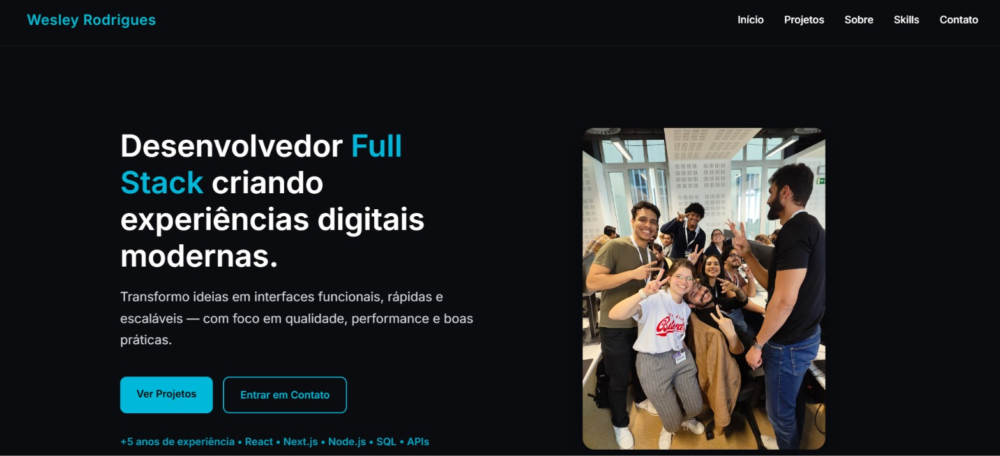

# Meu Portfólio — Wesley Rodrigues

Portfólio pessoal desenvolvido para apresentar minha trajetória como desenvolvedor web Full Stack, minhas habilidades técnicas e os projetos que venho construindo.

O projeto foi criado com foco em uma interface moderna, responsiva e acessível, proporcionando uma experiência de navegação simples tanto em computadores quanto em dispositivos móveis.

## Prévia da aplicação



## 🚀 Tecnologias utilizadas

- **Next.js 16** — framework React para construção da aplicação.
- **React 19** — desenvolvimento de interfaces baseadas em componentes.
- **TypeScript** — tipagem estática para maior segurança e organização do código.
- **Redux Toolkit** — gerenciamento do estado global da aplicação.
- **React Redux** — integração do Redux com os componentes React.
- **CSS Modules** — estilização isolada por componente.
- **React Icons** — utilização de ícones na interface.
- **ESLint** — análise estática e padronização do código.
- **Tailwind CSS 4** — dependência de desenvolvimento disponível no projeto.

## ✨ Funcionalidades

- Apresentação pessoal e profissional.
- Seções de projetos, sobre mim, habilidades e contato.
- Alternância entre os idiomas português e inglês.
- Alternância entre os temas claro e escuro.
- Apresentação de imagens no Hero com troca automática.
- Navegação adaptada para dispositivos móveis.
- Botão para retornar ao topo da página.
- Links para contato e perfis profissionais.
- Interface responsiva para diferentes tamanhos de tela.

## 🛠️ Como o projeto foi desenvolvido

A aplicação foi organizada em componentes reutilizáveis, separando as seções da página, os estilos e a lógica de gerenciamento de estado.

O Redux Toolkit é utilizado para centralizar estados compartilhados, como o idioma selecionado e o tema visual. A integração com React Redux permite que os componentes acessem e atualizem esses estados.

A interface utiliza CSS Modules para manter os estilos organizados por componente, enquanto variáveis CSS permitem adaptar cores e outros elementos visuais aos temas claro e escuro.

A estrutura também contempla a adaptação da navegação para telas menores, buscando manter uma experiência consistente em diferentes dispositivos.

## 📂 Estrutura principal

```text
src/
├── app/
│   ├── globals.css
│   ├── layout.tsx
│   └── page.tsx
├── components/
│   ├── layout/
│   └── sections/
├── features/
│   ├── language/
│   └── theme/
├── store/
└── styles/
    └── components/
```

A estrutura pode incluir outros arquivos e componentes conforme a evolução do projeto.

## ⚙️ Como executar localmente

### Pré-requisitos

- Node.js compatível com a versão do Next.js utilizada.
- npm.

### Instalação

Clone o repositório:

```bash
git clone URL_DO_REPOSITORIO
```

Entre na pasta do projeto:

```bash
cd meu-portfolio
```

Instale as dependências:

```bash
npm install
```

Inicie o servidor de desenvolvimento:

```bash
npm run dev
```

Acesse no navegador:

```text
http://localhost:3000
```

### Outros comandos

```bash
npm run build
npm run start
npm run lint
```

- `npm run build`: gera a versão de produção.
- `npm run start`: inicia a aplicação em modo de produção após o build.
- `npm run lint`: executa o ESLint.

## 🌐 Portfólio online

Acesse a versão publicada:

**[Meu Portfólio](https://meu-portifolio-kappa-ten.vercel.app/)**

## 👨‍💻 Autor

**Wesley Rodrigues**  
Desenvolvedor Web Full Stack

- GitHub: [dev-ley](https://github.com/dev-ley)
- LinkedIn: [wr-dev](https://www.linkedin.com/in/wr-dev/)

---

Desenvolvido por Wesley Rodrigues.
